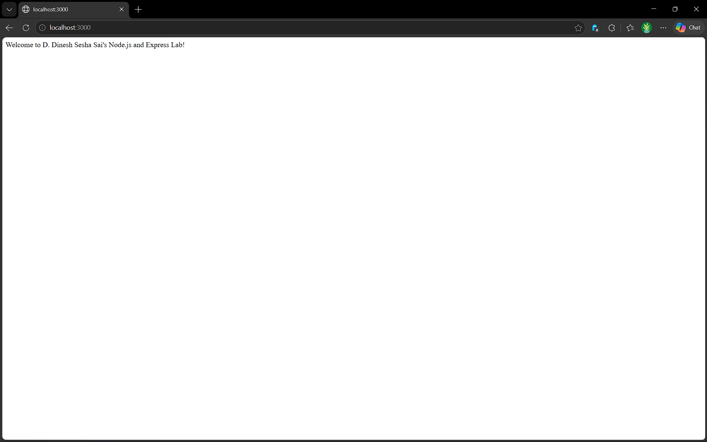
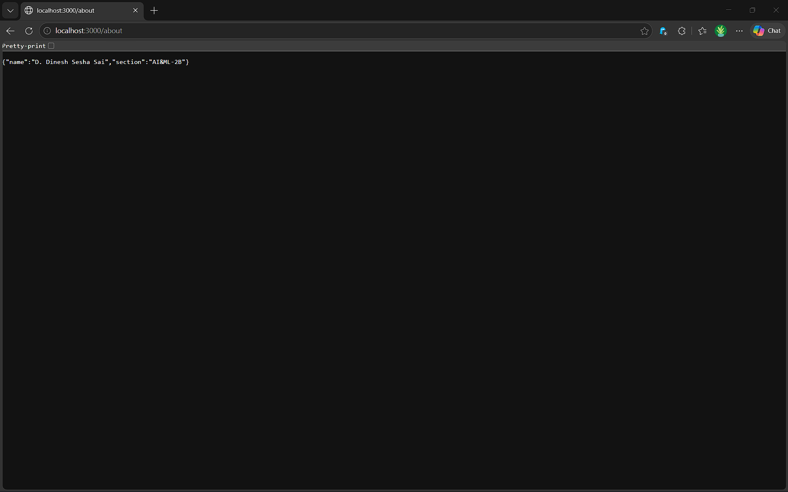
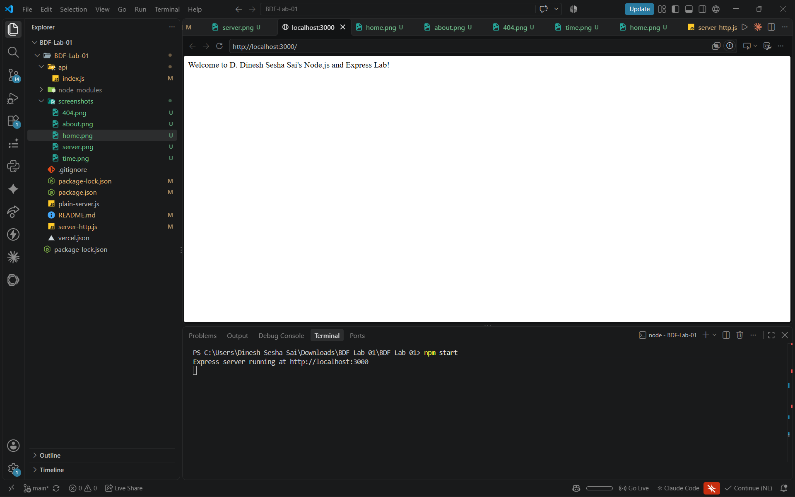

# Lab 1: Node.js and Express Server

## Student Details

- **Name:** D. Dinesh Sesha Sai
- **Registration Number:** 252U1R6063
- **Section:** AI&ML-2B
- **Course:** Backend Development Fundamentals

## Live Deployment

**Vercel URL:** https://backend-development-fundamentals-la-weld.vercel.app.

| Endpoint | Description |
|---|---|
| `/` | Welcome message |
| `/about` | Student information |
| `/time` | Current date and time |
| `/random` | 404 error handling |

## Objective

To create a basic web server using Node.js built-in HTTP module and develop an Express.js server with different routes, HTTP status codes, JSON responses, and 404 error handling.

## Technologies Used

- Node.js
- Express.js
- JavaScript
- Git and GitHub
- Vercel

## Project Structure

```text
BDF-Lab-01/
├── api/
│   └── index.js
├── screenshots/
├── .gitignore
├── package.json
├── package-lock.json
├── plain-server.js
├── server-http.js
├── vercel.json
└── README.md
```

## Prerequisites

- Node.js 18 or later
- npm
- Visual Studio Code

Check installed versions:

```bash
node -v
npm -v
```

## Installation

Clone your repository:

```bash
git clone YOUR_GITHUB_REPOSITORY_URL
cd YOUR_REPOSITORY_NAME
cd BDF-Lab-01
```

Install dependencies:

```bash
npm install
```

## Running the Servers

### 1. Node.js HTTP Server

Run:

```bash
node plain-server.js
```

Open:

`http://localhost:3000`

Expected response:

`Hello`

### 2. Express Server

Run:

```bash
npm start
```

Open:

`http://localhost:3000`

## API Endpoints

| Method | Endpoint | Description | Status |
|---|---|---|---|
| GET | `/` | Displays welcome message | 200 |
| GET | `/about` | Displays student name and section in JSON | 200 |
| GET | `/time` | Displays current date and time | 200 |
| GET | `/random` | Handles unknown routes | 404 |

## Screenshots

### 1. Home Route



### 2. About Route



### 3. Time Route


### 4. 404 Error Handling


### 5. Server Execution



## Concepts Learned

- Creating a Node.js project using `npm init`.
- Understanding `package.json` and `node_modules`.
- Creating an HTTP server using `http.createServer()`.
- Installing and using Express.js.
- Handling GET requests using Express routes.
- Returning JSON responses.
- Generating date and time using `new Date()`.
- Handling unknown routes with HTTP 404 status.
- Deploying a Node.js application using Vercel.
## Conclusion

Successfully developed a basic HTTP server using Node.js and an Express server with multiple GET routes, JSON responses, and 404 error handling. The application was also prepared for deployment using Vercel.

