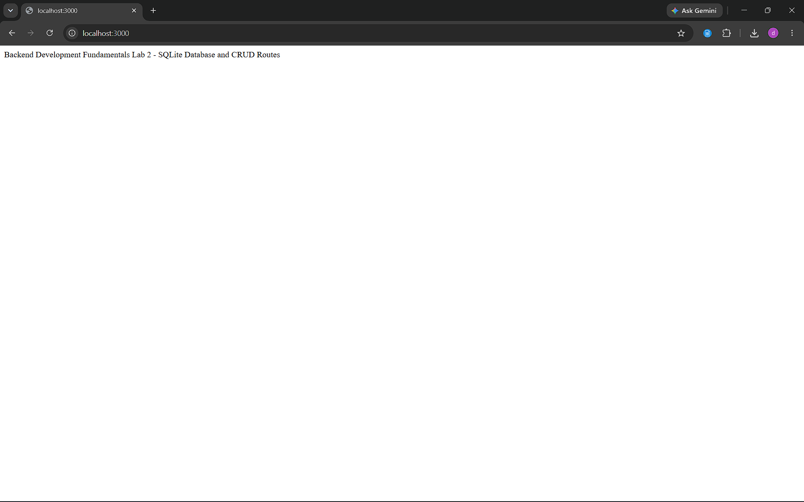
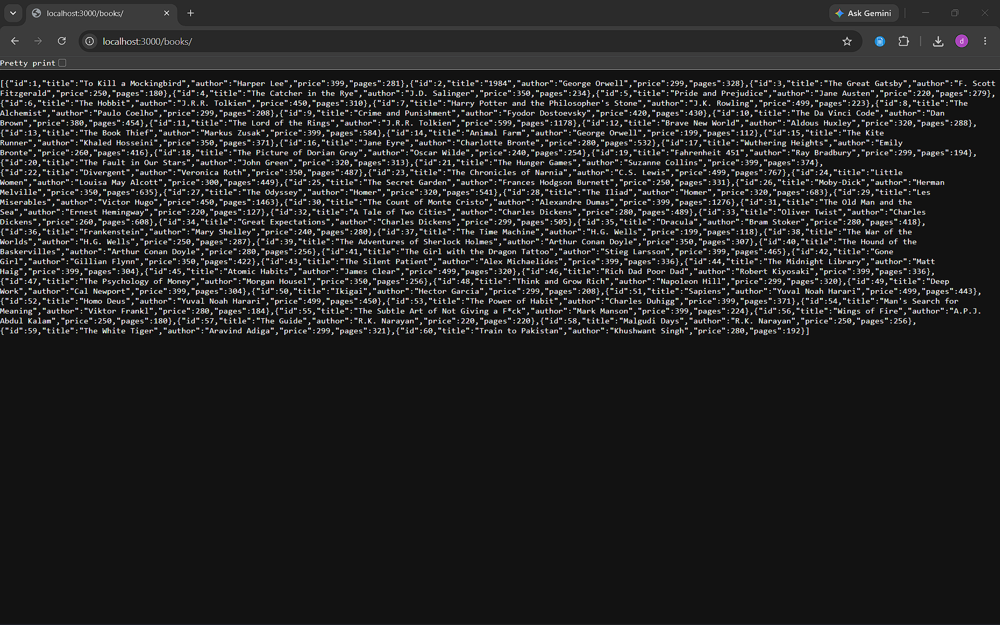
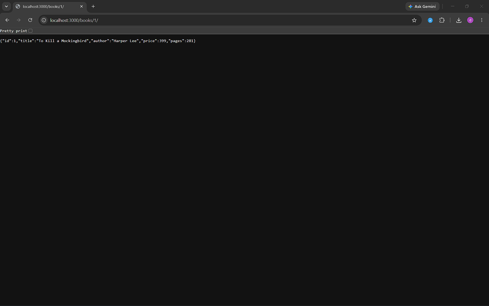
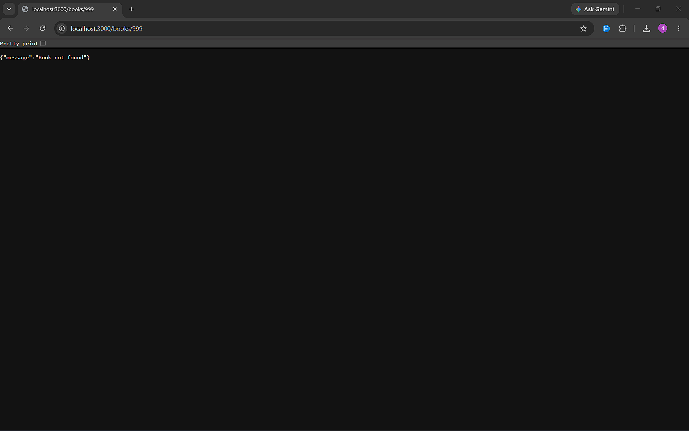
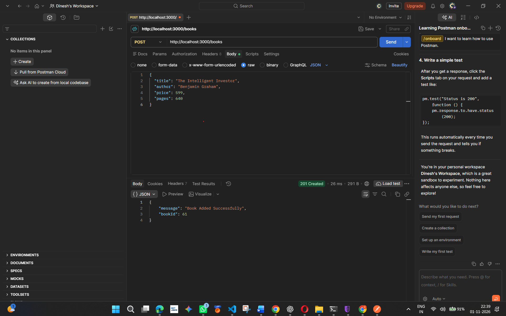
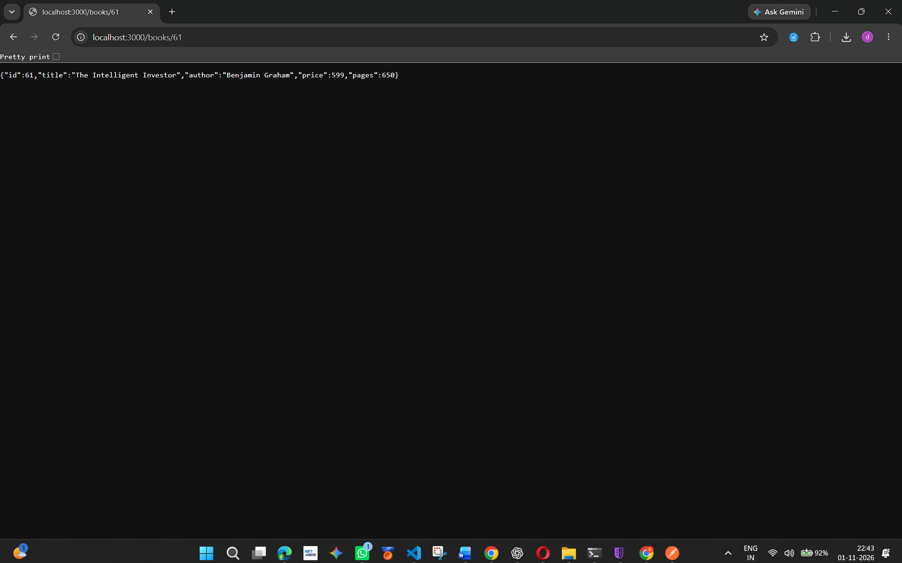
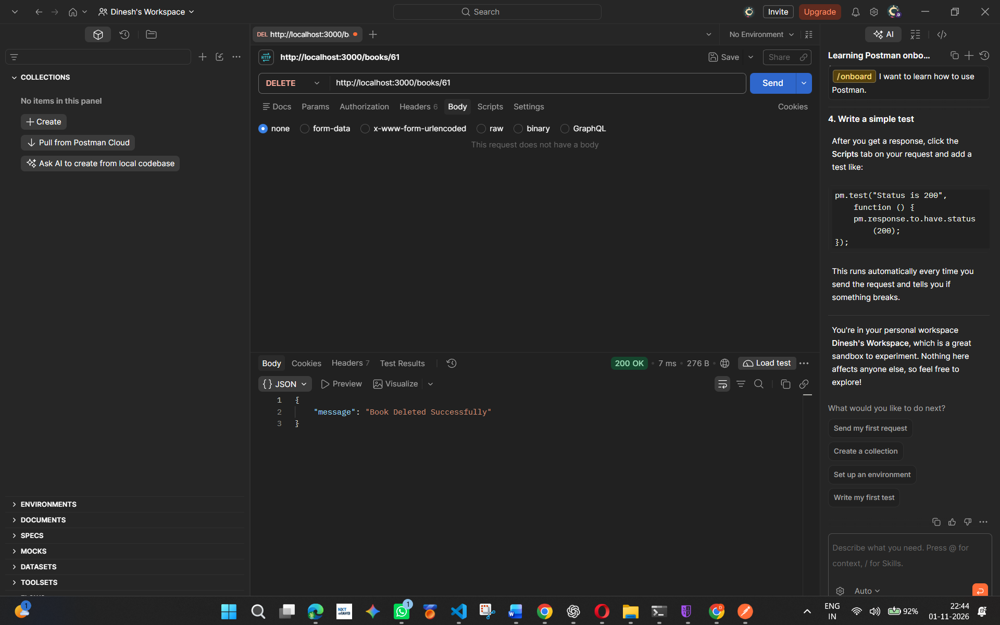
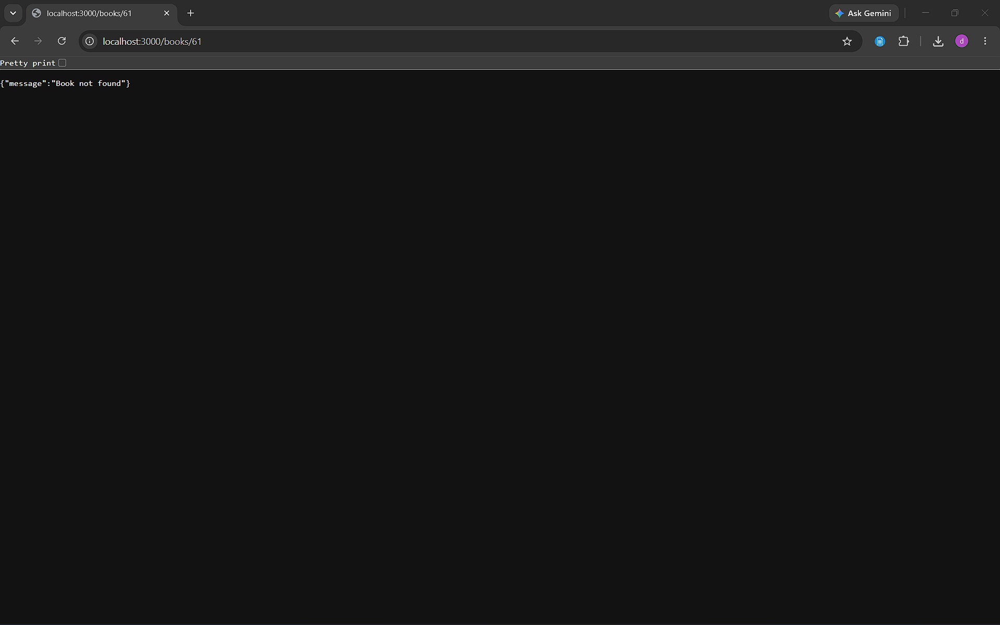

# Lab 2: SQLite Database and CRUD Routes

## Student Details

- **Name:** D. Dinesh Sesha Sai
- **Registration Number:** 252U1R6063
- **Section:** AI&ML-2B
- **Course:** Backend Development Fundamentals

## Technologies Used

- Node.js
- Express.js
- SQLite
- JavaScript
- Postman

## Project Description

This project demonstrates SQLite database integration with a Node.js and Express.js application.

It implements CRUD (Create, Read, Update, Delete) operations for managing a library of books.

The database is initialized with 60 sample books.

## Project Structure

```text
lab-02/
├── api/
│   └── index.js
├── database/
│   └── library.db
├── screenshots/
│   ├── home.png
│   ├── all-books.png
│   ├── single-book.png
│   ├── book-not-found.png
│   ├── post-book.png
│   ├── update-book.png
│   ├── updated-book.png
│   ├── delete-book.png
│   └── deleted-book.png
├── .gitignore
├── app.js
├── package.json
├── package-lock.json
├── README.md
└── vercel.json

## Project Links

- **GitHub Repository:** https://github.com/dinesh56142-svg/Backend-Development-Fundamentals
- **Localhost Home:** http://localhost:3000/
- **All Books:** http://localhost:3000/books
- **Live Deployment:** Pending deployment

## Database Details

- **Database:** SQLite
- **Database File:** `database/library.db`
- **Table Name:** `book`
- **Initial Sample Records:** 60

### Table Schema

| Column | Data Type | Description |
|---|---|---|
| `id` | INTEGER | Primary key and unique book identifier |
| `title` | TEXT | Title of the book |
| `author` | TEXT | Author of the book |
| `price` | REAL | Price of the book |
| `pages` | INTEGER | Number of pages |

## Installation and Execution

### 1. Navigate to the project directory

```bash
cd lab-02
```

### 2. Install Dependencies

```bash
npm install
```

### 3. Start the Server in Development Mode

```bash
npm run dev
```

### 4. Start the Server Normally

```bash
npm start
```

The application runs at:

`http://localhost:3000/`

## CRUD API Endpoints

| HTTP Method | Endpoint | Description |
|---|---|---|
| GET | `/` | Display the home message |
| GET | `/books` | Retrieve all books |
| GET | `/books/:bookId` | Retrieve a specific book |
| POST | `/books` | Add a new book |
| PUT | `/books/:bookId` | Update an existing book |
| DELETE | `/books/:bookId` | Delete a book |

### Sample POST Request

**Endpoint:** `POST /books`

```json
{
  "title": "The Intelligent Investor",
  "author": "Benjamin Graham",
  "price": 599,
  "pages": 640
}
```

### Sample PUT Request

**Endpoint:** `PUT /books/61`

```json
{
  "title": "The Intelligent Investor - Updated",
  "author": "Benjamin Graham",
  "price": 699,
  "pages": 650
}
```

## HTTP Status Codes

| Status Code | Description |
|---|---|
| 200 OK | Request completed successfully |
| 201 Created | New book created successfully |
| 400 Bad Request | Invalid request data |
| 404 Not Found | Requested book does not exist |
| 500 Internal Server Error | Server-side error |

## Lab Execution and Verification Screenshots

### 1. Home Route



### 2. Retrieve All Books



### 3. Retrieve a Single Book



### 4. Book Not Found



### 5. Add a New Book – POST



### 6. Update a Book – PUT


### 7. Verify Updated Book



### 8. Delete a Book – DELETE



### 9. Verify Deleted Book



## Implementation Highlights

- Integrated SQLite with Node.js and Express.js.
- Created and initialized the `book` database table.
- Inserted 60 sample book records.
- Implemented Create, Read, Update and Delete operations.
- Used parameterized SQL queries.
- Implemented request validation and appropriate HTTP status codes.
- Tested API endpoints using Postman and a web browser.

## Deployment

**Status:** Pending deployment.

The application has been tested locally. The live deployment URL will be added after successful deployment.