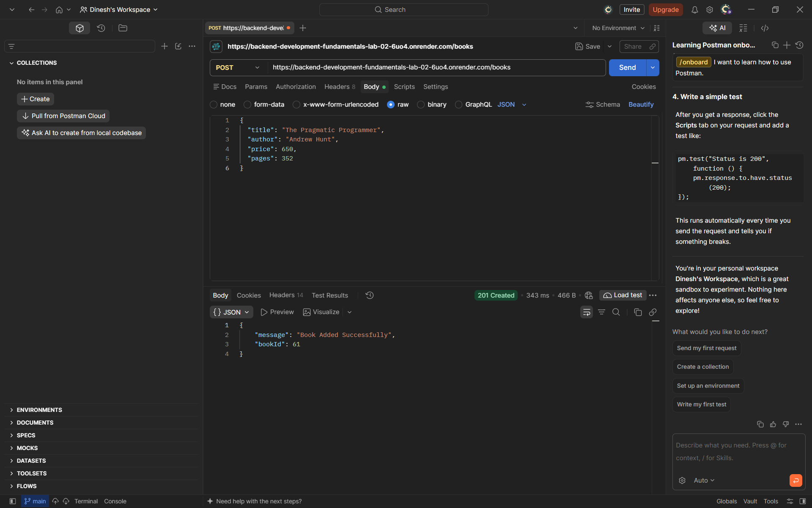
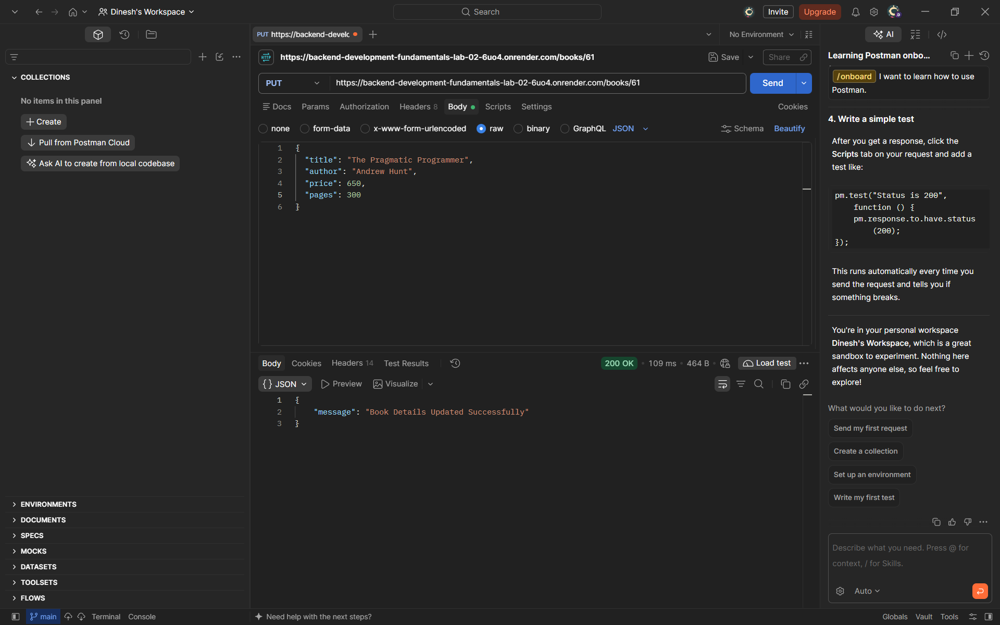
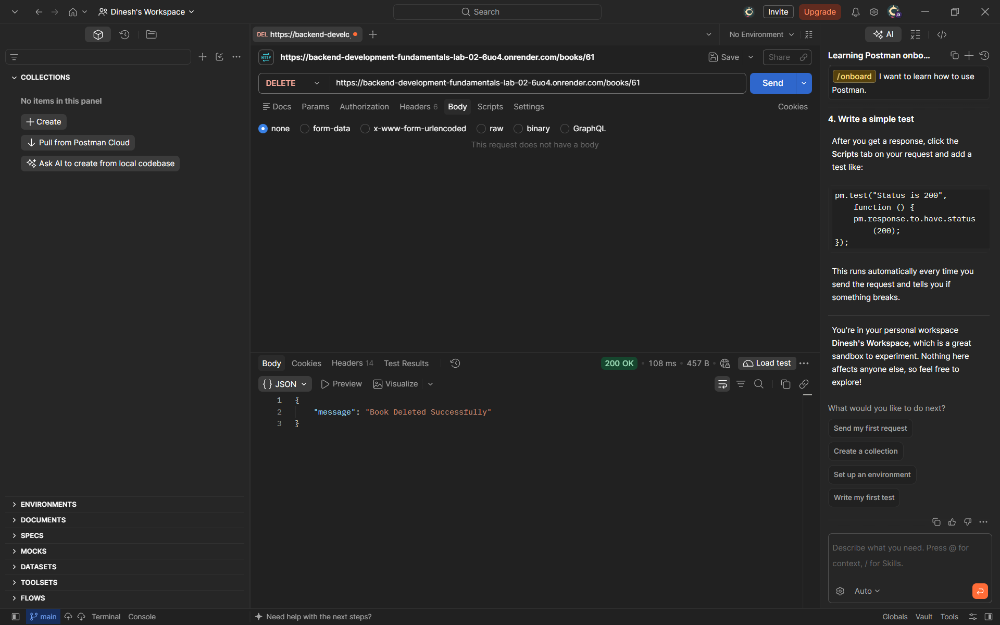

# Lab 2: SQLite Database and CRUD Routes

## Student Details

- **Name:** D. Dinesh Sesha Sai
- **Registration Number:** 252U1R6063
- **Section:** AI&ML-2B
- **Course:** Backend Development Fundamentals

## Technologies Used

- Node.js
- Express.js
- SQLite
- JavaScript
- Postman
- Render (Deployment)

## Project Description

This project demonstrates SQLite database integration with a Node.js and Express.js application.

It implements CRUD (Create, Read, Update, Delete) operations for managing a library of books. The database is initialized with 60 sample book records.

## Project Structure

```text
lab-02/
├── api/
│   └── index.js
├── database/
│   └── library.db
├── screenshots/
│   ├── home.png
│   ├── all-books.png
│   ├── single-book.png
│   ├── book-not-found.png
│   ├── post-book.png
│   ├── update-book.png
│   ├── updated-book.png
│   ├── delete-book.png
│   ├── deleted-book.png
│   ├── live-post-book.png
│   ├── live-update-book.png
│   └── live-delete-book.png
├── .gitignore
├── app.js
├── package.json
├── package-lock.json
├── README.md
└── vercel.json
```

## Project Links

- **GitHub Repository:** https://github.com/dinesh56142-svg/Backend-Development-Fundamentals
- **Render Live API:** https://backend-development-fundamentals-lab-02-6uo4.onrender.com
- **Live Home Route:** https://backend-development-fundamentals-lab-02-6uo4.onrender.com/
- **Live All Books:** https://backend-development-fundamentals-lab-02-6uo4.onrender.com/books
- **Local Home Route:** http://localhost:3000/
- **Local All Books:** http://localhost:3000/books

## Database Details

- **Database:** SQLite
- **Database File:** `database/library.db`
- **Table Name:** `book`
- **Initial Sample Records:** 60

### Table Schema

| Column | Data Type | Description |
|---|---|---|
| `id` | INTEGER | Primary key and unique book identifier |
| `title` | TEXT | Title of the book |
| `author` | TEXT | Author of the book |
| `price` | REAL | Price of the book |
| `pages` | INTEGER | Number of pages |

## Installation and Local Execution

### 1. Navigate to the Lab 2 directory

```bash
cd lab-02
```

### 2. Install Dependencies

```bash
npm install
```

### 3. Start the Server in Development Mode

```bash
npm run dev
```

### 4. Start the Server Normally

Alternatively, run:

```bash
npm start
```

The local application runs at:

`http://localhost:3000/`

## CRUD API Endpoints

The same API routes are available on the local server and the deployed Render service.

| HTTP Method | Endpoint | Description |
|---|---|---|
| GET | `/` | Display the home message |
| GET | `/books` | Retrieve all books |
| GET | `/books/:bookId` | Retrieve a specific book |
| POST | `/books` | Add a new book |
| PUT | `/books/:bookId` | Update an existing book |
| DELETE | `/books/:bookId` | Delete a book |

### Sample POST Request

**Endpoint:** `POST /books`

```json
{
  "title": "The Intelligent Investor",
  "author": "Benjamin Graham",
  "price": 599,
  "pages": 640
}
```

### Sample PUT Request

**Endpoint:** `PUT /books/61`

```json
{
  "title": "The Intelligent Investor - Updated",
  "author": "Benjamin Graham",
  "price": 699,
  "pages": 650
}
```

## HTTP Status Codes

| Status Code | Description |
|---|---|
| 200 OK | Request completed successfully |
| 201 Created | New book created successfully |
| 400 Bad Request | Invalid request data |
| 404 Not Found | Requested book does not exist |
| 500 Internal Server Error | Server-side error |

## Local Lab Execution and Verification Screenshots

### 1. Home Route


### 2. Retrieve All Books


### 3. Retrieve a Single Book


### 4. Book Not Found


### 5. Add a New Book – POST


### 6. Update a Book – PUT


### 7. Verify Updated Book


### 8. Delete a Book – DELETE


### 9. Verify Deleted Book


## Live Deployment Testing Screenshots

The deployed API was tested using Postman. All three write operations returned successful HTTP responses.

### 1. Create a Book – POST

**HTTP Status:** 201 Created



### 2. Update a Book – PUT

**HTTP Status:** 200 OK



### 3. Delete a Book – DELETE

**HTTP Status:** 200 OK



## Implementation Highlights

- Integrated SQLite with Node.js and Express.js.
- Created and initialized the `book` database table.
- Inserted 60 sample book records.
- Implemented Create, Read, Update and Delete operations.
- Used parameterized SQL queries.
- Implemented request validation and appropriate HTTP status codes.
- Tested API endpoints using Postman and a web browser.
- Configured the Express server to use the deployment platform's assigned port.

## Deployment on Render

**Deployment Platform:** Render  
**Deployment Status:** Live

The application is deployed as a Render Web Service.

### Render Configuration

| Setting | Value |
|---|---|
| Runtime | Node |
| Branch | `main` |
| Root Directory | `lab-02` |
| Build Command | `npm install` |
| Start Command | `npm start` |

### Live API

- **Base URL:** https://backend-development-fundamentals-lab-02-6uo4.onrender.com
- **All Books:** https://backend-development-fundamentals-lab-02-6uo4.onrender.com/books

### Deployment Notes

- The service uses the Render Free instance, which may spin down after inactivity. The first request after inactivity can take longer while the service starts again.
- The free instance does not provide persistent local disk storage. SQLite data written to the local database file may be lost when the service restarts or is redeployed.
- The database initializes 60 sample records when it is created.
- The project is connected to the GitHub `main` branch. New pushes can trigger a redeployment.

## Conclusion

The Lab 2 project successfully demonstrates SQLite database integration and CRUD operations using Node.js and Express.js. All API operations were tested locally and on the live Render deployment using Postman and a web browser.