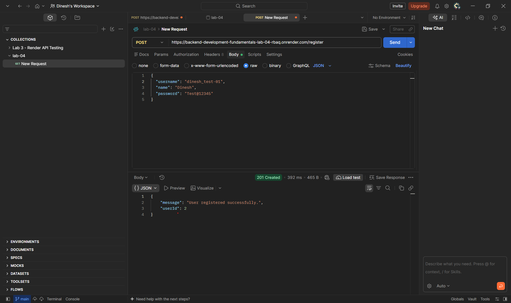
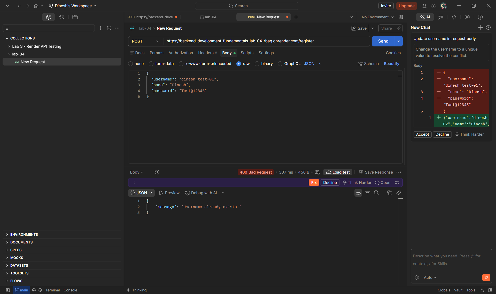
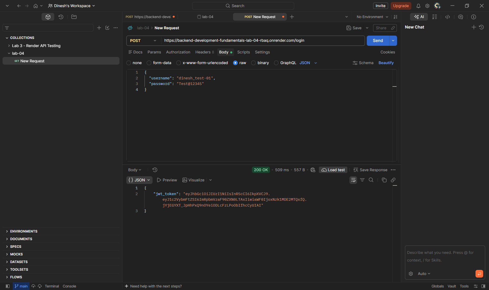
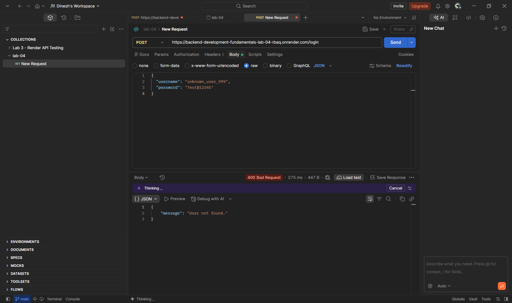
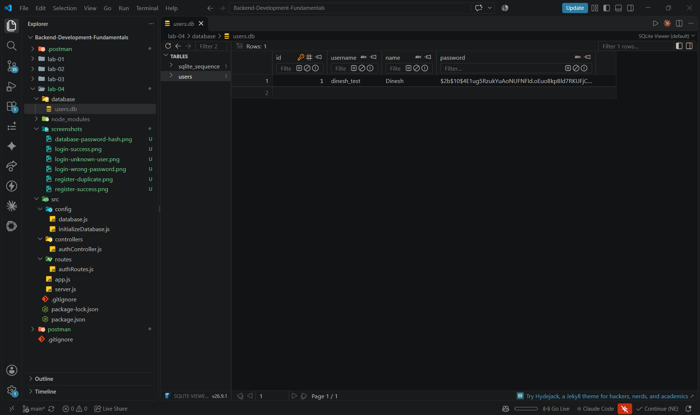
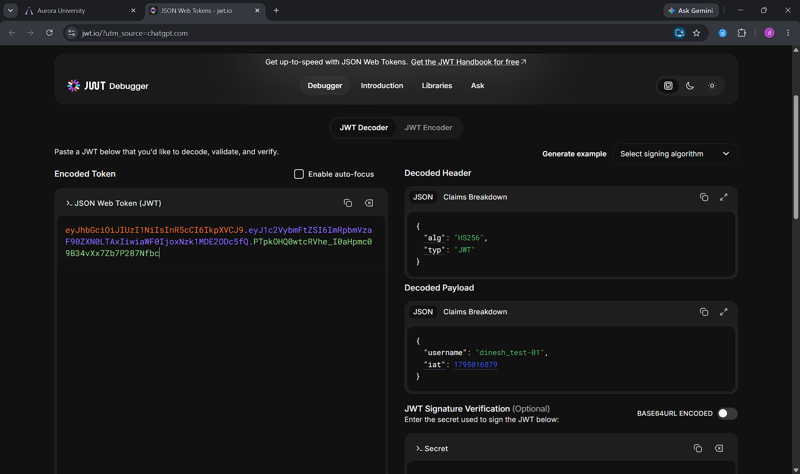

# Lab 4 – User Registration, Login and JWT Authentication

## Live Deployment

**Render URL:** https://backend-development-fundamentals-lab-04-rbaq.onrender.com

**Deployment Status:** Successfully deployed and tested.

## Student Details

- **Name:** D. Dinesh Sesha Sai
- **Registration Number:** 252U1R6063
- **Section:** AI&ML-2B
- **Course:** Backend Development Fundamentals
- **Lab Number:** 04

## Objective

To implement a user registration and login system using Express.js, SQLite, bcrypt password hashing and JSON Web Tokens (JWT).

## Technologies Used

- Node.js
- Express.js
- SQLite
- bcrypt
- jsonwebtoken
- Postman
- Render

## Project Structure

```text
lab-04/
├── database/
├── screenshots/
│   ├── register-success.png
│   ├── register-duplicate.png
│   ├── login-success.png
│   ├── login-unknown-user.png
│   ├── login-wrong-password.png
│   ├── database-password-hash.png
│   └── jwt-decoded.png
├── src/
│   ├── config/
│   │   ├── database.js
│   │   └── initializeDatabase.js
│   ├── controllers/
│   │   └── authController.js
│   ├── routes/
│   │   └── authRoutes.js
│   ├── app.js
│   └── server.js
├── .gitignore
├── package.json
├── package-lock.json
└── README.md
```

## Installation and Execution

### 1. Navigate to the Lab 4 directory

```bash
cd lab-04
```

### 2. Install dependencies

```bash
npm install
```

### 3. Start the development server

```bash
npm run dev
```

Alternatively, run:

```bash
npm start
```

The server uses port `5000` by default. When deployed, it uses the port provided by the hosting platform.

## Environment Variables

- `PORT` – Server port. Render provides this automatically.
- No manually configured environment variables are required for this lab.
- The JWT signing secret is defined as a constant in the application, as specified in the lab instructions.

## API Endpoints

**Base URL:**

```text
https://backend-development-fundamentals-lab-04-rbaq.onrender.com
```

| Method | Endpoint | Description |
|---|---|---|
| GET | `/` | Checks API server status |
| POST | `/register` | Registers a new user |
| POST | `/login` | Authenticates a user and returns a JWT |

### Registration Request

**POST `/register`**

Request body:

```json
{
  "username": "dinesh_test-01",
  "name": "Dinesh",
  "password": "Test@12345"
}
```

- Checks whether the username already exists.
- Hashes the password using `bcrypt.hash()`.
- Stores the user details and hashed password in SQLite.
- Returns `201 Created` when registration is successful.
- Returns `400 Bad Request` when the username already exists.

### Login Request

**POST `/login`**

Request body:

```json
{
  "username": "dinesh_test-01",
  "password": "Test@12345"
}
```

- Checks whether the username exists.
- Compares the submitted password with the stored hash using `bcrypt.compare()`.
- Generates a JWT using `jwt.sign()` after successful authentication.
- Returns the JWT token when login is successful.
- Returns `400 Bad Request` for an unknown username or incorrect password.

## JWT Implementation

The application generates JSON Web Tokens using the `jsonwebtoken` package.

- **Signing algorithm:** HS256
- **Token type:** JWT
- **Token payload:** Username only
- **Issued-at (`iat`) claim:** Generated automatically.
- **Secret:** Stored as a constant in the application for this lab.

The password is never included in the JWT payload.

## Testing and Screenshots

All required registration and login test cases were performed using Postman against the deployed Render application.

### 1. Successful User Registration



### 2. Duplicate Username Registration



### 3. Successful User Login



### 4. Login with Unknown Username



### 5. Login with Incorrect Password


### 6. Password Hash Verification in SQLite



### 7. JWT Decoding and Payload Verification



## Expected Results

- Users can register with a unique username.
- Duplicate usernames are rejected.
- Passwords are stored as bcrypt hashes rather than plaintext.
- Valid login credentials return a JWT.
- Unknown usernames and incorrect passwords are rejected.
- The JWT payload contains the username and does not contain the password.
- The application is successfully deployed on Render.

## Conclusion

The user registration and login system was successfully implemented using Express.js and SQLite. Password security was implemented using bcrypt hashing, and JWT-based token generation was integrated for successful authentication. All required test cases were executed using Postman, and the application was successfully deployed on Render.
